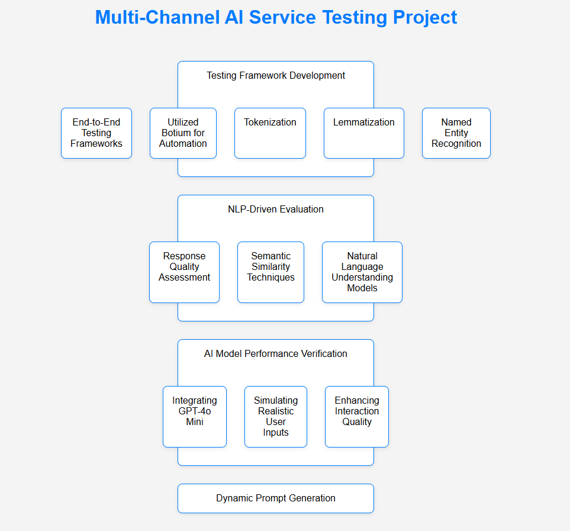
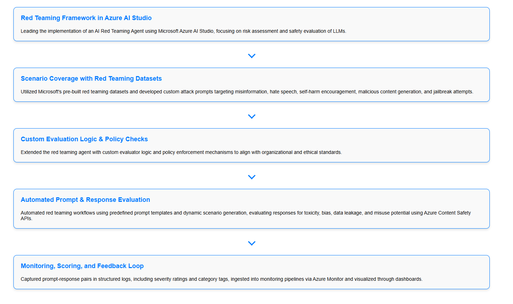
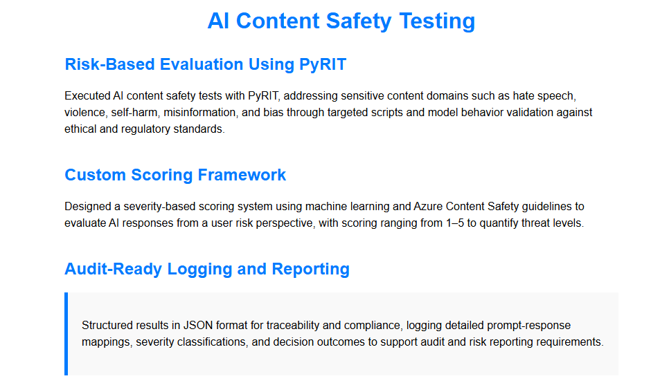

# AI Quality Engineering & Evaluation Governance

**Krish Sabu | Conversational AI Testing · LLM Red Teaming · Release Governance**

A professional portfolio documenting my experience in conversational AI quality assurance, risk-based LLM evaluation, and content safety testing, alongside a public reference architecture for AI release governance.

My focus is connecting test evidence, system behaviour, and release risk so teams can make informed decisions about changes to AI systems.

## Start Here

### AI Evaluation Harness — Reference Architecture

A proposed governance approach for evaluating changes to models, prompts, retrieval configurations, and agent workflows before release.

- [Architecture documentation](ai-eval-harness/README.md)
- [Overview page source](ai-eval-harness/index.html)
- [Evaluation approach page source](ai-eval-harness/how-it-works.html)
- [Method change governance page source](ai-eval-harness/method-change.html)

**Status:** Static documentation website built with HTML, CSS, and JavaScript. It does not execute evaluations, generate release verdicts, enforce CI/CD gates, or issue certifications.

To view the website locally, open `ai-eval-harness/index.html` in your browser. The HTML links above display source files when viewed on GitHub.

## Quality Engineering Focus

- **Conversational reliability:** Validate dialogue flows, contextual responses, and behaviour across channels.
- **Risk-based evaluation:** Select scenarios and checks according to potential user harm and system impact.
- **Adversarial testing:** Examine jailbreak attempts, unsafe responses, data leakage, and misuse risks.
- **Evaluation traceability:** Connect prompts, responses, scores, and findings through structured records.
- **Release governance design:** Define proposed acceptance criteria, regression checks, review ownership, and evidence requirements.

## Selected Professional Experience

The summaries below describe professional work and technical experience. They are not claims that equivalent implementations are included in this public repository.

### 1. Multi-Channel Conversational AI Testing

Designed and implemented automated testing frameworks for a utility-sector conversational AI solution, covering scripted and LLM-powered interactions.

**Key contributions**

- Used Botium to automate user journeys and validate conversational flows across scenarios and platforms.
- Assessed response quality using semantic similarity and natural language understanding techniques.
- Applied NLP techniques to support analysis of intent, entities, and contextual behaviour.
- Worked on dynamic prompt generation with GPT-4o Mini to broaden simulated user-input coverage.

**Quality focus:** Dialogue correctness, contextual relevance, scenario coverage, and repeatable testing.

### 2. Azure-Based LLM Red Teaming

Worked on red teaming workflows in Azure AI Studio to assess LLM safety and misuse risks.

**Key contributions**

- Used pre-built datasets and custom adversarial prompts to examine harmful content, misinformation, and jailbreak attempts.
- Developed custom evaluation logic and policy-aligned checks.
- Automated prompt-response evaluation using Azure AI Content Safety APIs.
- Captured structured findings, severity ratings, and category tags for monitoring and investigation.
- Used Azure Monitor and dashboards to support visibility into evaluation findings.

**Quality focus:** Adversarial coverage, consistent assessment, and actionable risk reporting.

### 3. Risk-Based Content Safety Testing with PyRIT

Used PyRIT to exercise sensitive-content scenarios and assess model responses against defined safety expectations.

**Key contributions**

- Tested scenarios involving hate speech, violence, self-harm, misinformation, and bias.
- Designed a custom 1–5 severity scale to support risk prioritisation.
- Recorded prompt-response mappings, severity classifications, and decision outcomes in structured JSON.
- Produced traceable findings to support review and reporting.

**Quality focus:** Harm identification, severity assessment, and evidence-based review.

The severity scale is a custom assessment approach, not a universal standard or a certification of model safety.

## Reference Architecture: Proposed Governance Controls

The AI Evaluation Harness documentation explores:

- Versioned configuration manifests for identifying AI method changes.
- Tiered evaluation using operational signals, reference-free checks, and verified ground truth.
- Risk-based evaluation scope and predefined acceptance criteria.
- GO, REVIEW, and NO-GO decision categories.
- Baseline comparisons and cross-tier regression assessment.
- Judge calibration, dataset provenance, and evaluation limitations.
- Evidence records, release approvals, controlled rollout, and rollback planning.

These are proposed design controls. Enforcing them would require an executable service, tested decision logic, protected evidence storage, and deployment-platform integration.

## Tools and Technologies

**Professional experience described above**

Botium · PyRIT · Azure AI Studio · Azure AI Content Safety · Azure Monitor · GPT-4o/GPT-4o Mini · NLP techniques · JSON reporting

**Potential integrations discussed in the reference architecture**

RAGAS · DeepEval · CI/CD release checks · Versioned evaluation datasets · Evidence storage

Mentioning a tool as a potential integration does not mean it is implemented in this repository.

## Scope and Confidentiality

This repository presents public portfolio material and an independently documented reference architecture.

- Professional experience summaries are distinct from publicly available code and documentation.
- The reference architecture does not establish employer adoption, production deployment, or measured business outcomes.
- Illustrative scores, thresholds, sample sizes, and records are not verified evaluation results.
- Proprietary code, customer data, credentials, and internal operational records must not be included in public material.
- Evaluation findings support decisions within a defined scope; they do not establish universal correctness, safety, or regulatory compliance.